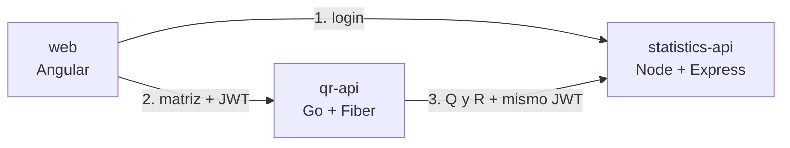

# Factorización QR: reto técnico

Sistema de dos APIs y un frontend. Una API en Go calcula la factorización QR de una matriz rectangular, otra en Node.js
calcula estadísticas sobre el resultado, y un frontend en Angular muestra la ecuación `A = Q · R` y comprueba que se cumple.

## Demo en línea

<https://ashy-meadow-0e8a5160f.4.azurestaticapps.net>

Las credenciales se entregan por separado. Los servicios escalan a cero, así que la primera petición tras un rato sin uso tarda más.

## Cómo probarlo en local

Necesitas Docker y Node.js 24.15 o superior.

1. **Genera las claves y el usuario de demo.** Se guardan en un `.env` que no se sube al repositorio, y el comando
   muestra la contraseña una sola vez:

   ```bash
   npm --prefix services/statistics-api ci
   ```

   ```bash
   npm --prefix services/statistics-api run generate-env
   ```

2. **Levanta el sistema:**

   ```bash
   docker compose up --build
   ```

3. **Abre <http://localhost:4200>** e inicia sesión con el usuario `demo` y la contraseña del paso 1.

### Probar las APIs sin el frontend

```bash
TOKEN=$(curl -s localhost:3000/api/v1/auth/token -H 'Content-Type: application/json' -d '{"username":"demo","password":"<contraseña>"}' | jq -r .accessToken)
```

```bash
curl -s localhost:8080/api/v1/qr-factorizations -H "Authorization: Bearer $TOKEN" -H 'Content-Type: application/json' -d '{"matrix":[[1,2],[3,4],[5,6]]}' | jq
```

Los contratos completos están en [qr-api](services/qr-api/api/openapi.yaml) y
[statistics-api](services/statistics-api/api/openapi.yaml).

## Arquitectura



Cada API sigue una arquitectura hexagonal: el dominio no conoce HTTP, JSON ni JWT, y una prueba hace fallar el build si
eso se rompe. El detalle está en [docs/architecture.md](docs/architecture.md).

## Decisiones técnicas

El enunciado pide tomar decisiones y sustentarlas. Estas son las principales:

| Decisión | Por qué | Detalle |
|---|---|---|
| QR con rotaciones de Givens | El enunciado pide "factorización QR" y también habla de "rotación": una QR de Givens es una secuencia de rotaciones | [ADR 0001](docs/adr/0001-qr-with-givens-rotations.md) |
| Node emite el JWT, con firma ES256 | Go solo tiene la clave pública y no puede falsificar tokens; el frontend consume ambas APIs de forma natural | [ADR 0002](docs/adr/0002-jwt-issuer-and-signing.md) |
| QR reducida | Para una matriz de 1000×3, Q es de 1000×3 y no de 1000×1000, sin perder información | [ADR 0003](docs/adr/0003-reduced-qr.md) |
| Sin base de datos | El enunciado no la pide y las operaciones son puras | [ADR 0004](docs/adr/0004-stateless-no-database.md) |

## Pruebas

| Comando | Qué cubre |
|---|---|
| `go test ./...` en `services/qr-api` | Propiedades de la QR, gonum como oráculo, handlers, ataques al JWT, arquitectura |
| `go test -run='^$' -fuzz=FuzzDecompose -fuzztime=30s ./internal/factorization/` | Las propiedades de la QR con entradas generadas |
| `npm test` en `services/statistics-api` | Estadísticas, login, rutas, ataques al JWT, arquitectura |
| `npm test -- --watch=false` en `web` | Parser, sesión, interceptor, pantallas, arquitectura |
| `node tests/e2e/run.mjs` | Flujo completo contra contenedores reales, con secretos desechables |

Las pruebas E2E necesitan haber corrido `npm ci` en `services/statistics-api`.

## Desarrollo sin Docker

Exporta las variables de la tabla siguiente en cada terminal y arranca cada parte:

```bash
go -C services/qr-api run ./cmd/api
```

```bash
npm --prefix services/statistics-api run dev
```

```bash
npm --prefix web start
```

## Configuración

Cada servicio valida su configuración al arrancar y se detiene si algo falta.

| Variable | Servicio | Por defecto | Descripción |
|---|---|---|---|
| `JWT_PUBLIC_KEY_B64` | Ambos | Requerida | Clave pública P-256 (SPKI PEM) en base64 |
| `JWT_ISSUER`, `JWT_AUDIENCE` | Ambos | Requeridas | Valores de `iss` y `aud` |
| `CORS_ALLOWED_ORIGINS` | Ambos | Requerida | Orígenes permitidos, separados por comas; no admite `*` |
| `PORT` | Ambos | 8080 en Go, 3000 en Node | Puerto |
| `LOG_LEVEL` | Ambos | `info` | Nivel de logs |
| `TZ` | Ambos | `America/Lima` en las imágenes | Zona horaria del servidor |
| `STATISTICS_API_URL` | qr-api | Requerida | Dirección de statistics-api |
| `STATISTICS_TIMEOUT` | qr-api | `30s` | Tiempo máximo de espera a statistics-api |
| `JWT_PRIVATE_KEY_B64` | statistics-api | Requerida | Clave privada P-256 (PKCS8 PEM) en base64 |
| `DEMO_USERNAME` | statistics-api | Requerida | Usuario de demo |
| `DEMO_PASSWORD_HASH_B64` | statistics-api | Requerida | Hash bcrypt de la contraseña, en base64 |
| `JWT_TTL_SECONDS` | statistics-api | `900` | Vida del token |
| `LOGIN_RATE_LIMIT_MAX` | statistics-api | `10` | Intentos de login por minuto |
| `TRUST_PROXY_HOPS` | statistics-api | `0` | Proxies delante del servicio |
| `BODY_LIMIT` | statistics-api | `4mb` | Tamaño máximo del cuerpo |

## Despliegue

Las APIs se despliegan en Azure Container Apps y el frontend en Azure Static Web Apps, con infraestructura como código en
Bicep. Los pasos están en [docs/deployment.md](docs/deployment.md).
