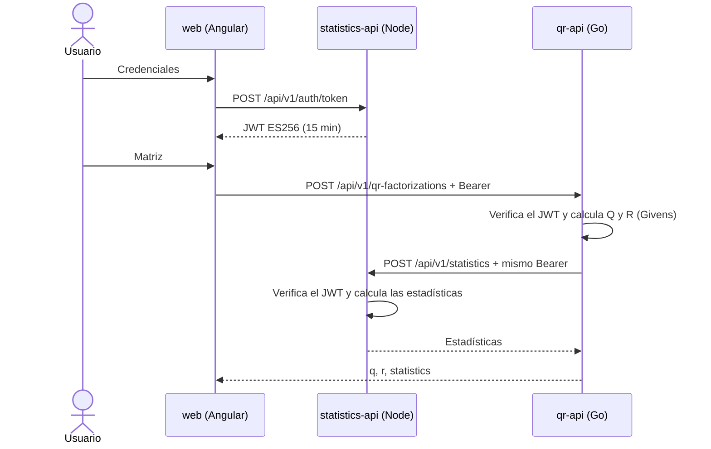
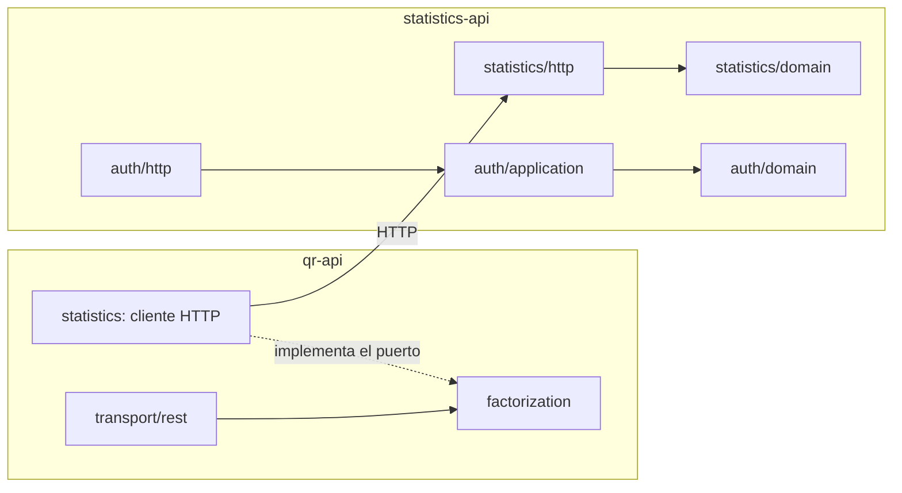

# Arquitectura

Dos APIs sin estado y un frontend. El usuario inicia sesión en Node, le pide la factorización QR a Go, y Go le pide
las estadísticas a Node con el mismo token. La respuesta final trae Q, R y las estadísticas.

## Flujo principal

## Componentes

| Componente | Responsabilidad | Tecnología |
|---|---|---|
| `services/qr-api` | Validar la matriz, calcular la QR y orquestar la llamada a estadísticas | Go 1.26, Fiber v3 |
| `services/statistics-api` | Emitir tokens y calcular estadísticas sobre matrices | Node 24, Express 5, TypeScript |
| `web` | Iniciar sesión, capturar la matriz y mostrar resultados | Angular 22 |
| `infra` | Definir los recursos en Azure | Bicep |

## Contratos

Cada API publica su OpenAPI en `services/<api>/api/openapi.yaml`.

| Endpoint | Entra | Sale |
|---|---|---|
| `POST /api/v1/auth/token` (Node) | `{ "username", "password" }` | `{ "accessToken", "expiresIn" }` |
| `POST /api/v1/qr-factorizations` (Go) | `{ "matrix": [[1,2],[3,4],[5,6]] }` | `{ "q", "r", "statistics" }` |
| `POST /api/v1/statistics` (Node) | `{ "matrices": [{ "name", "values" }] }` | `{ "max", "min", "average", "sum", "hasDiagonalMatrix", "matrices": [{ "name", "isDiagonal" }] }` |
| `GET /health` (ambas) | — | `{ "status": "ok" }` |

**Por qué `{ "matrix": ... }` y no un array suelto:** el enunciado pide "un array de arrays de números", y ese array
es el valor del campo. Un objeto en la raíz permite agregar opciones más adelante sin romper a quien ya consume la API.

**Por qué las estadísticas son genéricas:** Node recibe matrices con nombre y no sabe que vienen de una QR. Así se
puede probar y reutilizar sin Go.

## Errores

Ambas APIs responden con un único formato, RFC 9457 (`application/problem+json`).

| Situación | Código |
|---|---|
| JSON mal formado | 400 |
| Sin token, token inválido o credenciales incorrectas | 401 |
| Cuerpo mayor al tamaño permitido | 413 |
| Matriz vacía, filas desiguales, excede el tamaño máximo o desborde numérico | 422 |
| Demasiados intentos de inicio de sesión | 429 |
| Node responde con error o no se puede alcanzar | 502 |
| Node no responde a tiempo | 504 |

## Capas (hexagonal)

Las dependencias apuntan hacia el dominio. El dominio no conoce HTTP, JSON ni JWT, y un guardián en cada servicio hace
fallar las pruebas si eso se rompe.

## Atributos de calidad

| Atributo | Decisión |
|---|---|
| Seguridad | JWT ES256 con algoritmo fijo y validación de `iss`, `aud` y `exp`; lista de orígenes CORS; límites de tamaño de cuerpo y dimensiones; límite de intentos de login; contenedores sin root; secretos fuera del repositorio |
| Rendimiento | QR en O(mn²) con memoria contigua; estadísticas en una sola pasada O(N) |
| Resiliencia | Timeout configurable de Go a Node, 30 s por defecto, sin reintentos; apagado ordenado en ambas APIs |
| Observabilidad | Logs JSON (`slog`, `pino`) y `X-Request-ID` propagado de Go a Node |
| Hora | Hora local del servidor con `TZ=America/Lima` en cada despliegue; el `exp` del JWT es numérico por estándar |

**Por qué 30 s de timeout:** con escala a cero, Node puede tardar varios segundos en despertar. Un timeout corto
convertiría la primera petición de cada demo en un 504.

## Pruebas

| Nivel | Qué asegura |
|---|---|
| Unitarias | Propiedades de la QR (A = QR, QᵀQ = I, R triangular) y reglas de estadísticas y autenticación |
| Fuzz (Go) | Las propiedades de la QR se mantienen con entradas generadas |
| Integración | Rutas con JWT real, incluidos ataques como `alg: none` y confusión de algoritmo |
| Guardianes | Reglas de arquitectura que hacen fallar el build |
| E2E | Inicio de sesión → QR → estadísticas contra contenedores reales |

## Decisiones

| ADR | Decisión |
|---|---|
| [0001](adr/0001-qr-with-givens-rotations.md) | QR con rotaciones de Givens, y cómo se resuelve "rotación" vs "QR" |
| [0002](adr/0002-jwt-issuer-and-signing.md) | Node emite el JWT con firma asimétrica |
| [0003](adr/0003-reduced-qr.md) | QR reducida para matrices rectangulares |
| [0004](adr/0004-stateless-no-database.md) | Sin base de datos |
